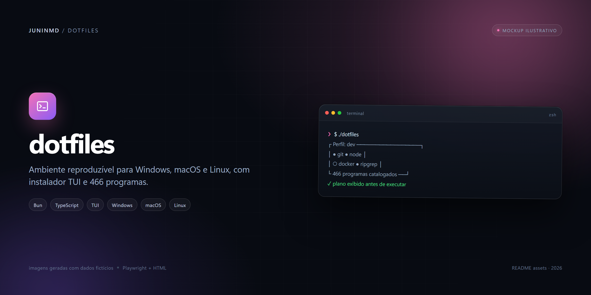
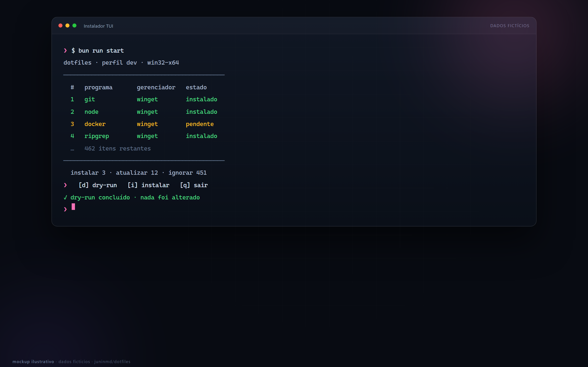

# dotfiles

<p align="center">
  
</p>

Ambiente de desenvolvimento reproduzível para **Windows, macOS e Linux**, com um instalador TUI (TypeScript + Bun) que lê um catálogo de 466 programas, mostra o plano antes de executar e instala cada item pelo gerenciador nativo do sistema.

📖 Documentação: <https://juninmd.github.io/dotfiles/> · ⬇️ Download: <https://juninmd.github.io/dotfiles/download>

## Estado atual da distribuição

O site e os scripts de bootstrap estão publicados, mas **não há release com os binários** que eles baixam. No momento, a API de releases retorna apenas um rascunho (`v0.0.1`) sem assets, então `https://github.com/juninmd/dotfiles/releases/latest/download/dotfiles-*` ainda não resolve. Até a primeira release, o caminho que funciona é compilar o instalador a partir do código.

## Instalação a partir do código

Pré-requisitos: [Bun](https://bun.sh) e `git`. O instalador em si não exige Node.

```bash
git clone https://github.com/juninmd/dotfiles.git
cd dotfiles/installer
bun install
bun src/index.ts --help
```

O script `start` do `package.json` é exatamente `bun src/index.ts`, então rodar pelo Bun direto dá o mesmo resultado e não deixa dúvida sobre o encaminhamento de flags. Para gerar um binário único:

```bash
bun run build       # bun build src/index.ts --compile --outfile dist/dotfiles
```

O executável fica em `installer/dist/` (no Windows, com extensão `.exe`). Ele não é copiado para o `PATH`; rode pelo caminho completo.

### Bootstrap oficial

Os scripts `docs/public/install.sh` e `docs/public/install.ps1` baixam o binário da release mais recente, conferem o SHA-256 e só então executam. Quando houver release, o uso pretendido é este, no macOS/Linux:

```sh
curl -fsSL https://juninmd.github.io/dotfiles/install.sh | sh -s -- --profile dev --dry-run
```

No Windows, salve o script e passe os argumentos:

```powershell
irm https://juninmd.github.io/dotfiles/install.ps1 -OutFile install.ps1
.\install.ps1 --profile dev --dry-run
```

No macOS/Linux, o `sh -s --` encaminha os argumentos ao script; o instalador roda o binário temporário e apaga o diretório ao final. No Windows, `@args` só é preenchido quando o script é chamado com argumentos — por isso o `irm | iex` sem parâmetros abre a TUI, mas não aceita flags.

### Instalador shell legado (Linux)

O repositório mantém `setup.sh` e `setup-2026.sh`, que não dependem do binário publicado e executam os scripts de `programas/`:

```bash
git clone https://github.com/juninmd/dotfiles.git
cd dotfiles
./setup-2026.sh --profile dev --dry-run
```

O `--dry-run` imprime cada módulo sem rodar o `setup.sh` correspondente. É uma alternativa ao instalador TUI, com a mesma base de scripts e opções próprias de perfil.

## Uso

```text
dotfiles [--profile <nome>] [--dry-run] [--yes]
```

| Flag | Efeito |
|---|---|
| `--profile <nome>` | Usa um perfil do catálogo (`minimal`, `dev`, `ai-dev`) sem abrir o seletor |
| `--dry-run` | Monta e imprime o plano; nenhum comando é executado |
| `--yes` | Pula a confirmação “Executar o plano?” |
| `--help`, `-h` | Mostra o uso e a lista de perfis |

Sem argumentos, a TUI pergunta o perfil e oferece **Personalizado**, que filtra os módulos com suporte ao seu sistema e permite marcar vários com busca por nome/categoria. Um perfil desconhecido encerra com código `2`; se algum módulo falhar, o instalador termina com código `1` e lista os que falharam.

Fluxo recomendado — primeiro simular, depois executar:

```bash
bun src/index.ts --profile dev --dry-run
bun src/index.ts --profile dev --yes
```

O `--dry-run` ainda monta o plano real (com `sudo`, `brew`, `winget` ou `bash`), mas `runCommand` retorna sucesso sem iniciar processo algum — nada é instalado.

## Perfis

Os perfis são os do catálogo (`installer/catalog/catalog.json`), não uma lista fixa no código:

| Perfil | Descrição no catálogo | Módulos | Exemplos |
|---|---|---|---|
| `minimal` | Shell moderna, prompt e editor | 5 | `git`, `bat`, `ripgrep`, `starship`, `vscode` |
| `dev` | Minimal + runtimes, containers e produtividade | 18 | `bun`, `docker`, `fish`, `kitty`, `lazygit`, `nvm`, `rclone`, `restic` |
| `ai-dev` | Dev + ferramentas de IA | 46 | `claude-code`, `ollama`, `aider`, `cline`, `lm-studio`, `llama.cpp`, `huggingface-cli` |

`ai-dev` é uma lista própria: inclui os itens de IA e parte da base, mas não é um superconjunto literal de `dev` (por exemplo, não lista `docker`, `fzf` ou `lazygit`). Para combinar exatamente o que você quer, use o perfil **Personalizado**.

## O que o instalador altera no sistema

Cada módulo tem um passo por sistema operacional, executado pelo gerenciador nativo:

| Sistema | Mecanismo | Exemplos |
|---|---|---|
| Linux | `sudo apt-get install -y` (3 módulos) ou `bash programas/<id>/setup.sh` (463) | `git` via apt; `zsh`, `docker`, `claude-code` via script |
| macOS | `brew install`, `brew install --cask` (23) ou script (6) | `git` via brew; `docker` via cask; `zsh` via script |
| Windows | `winget install --id <id> -e` (453), script (10) ou `npm install -g` (3) | `Git.Git`, `Docker.DockerDesktop`, `Anthropic.ClaudeCode` |

No Linux, os scripts de `programas/` costumam ir além do pacote: instalam plugins, copiam arquivos para `~/.config`, acrescentam blocos ao `~/.zshrc` e rodam `code --install-extension` (o script do VS Code instala uma lista fixa de extensões). Alguns fazem backup antes de editar — o `zsh`, por exemplo, copia `~/.zshrc` para `~/.zshrc.backup.<data>` antes de anexar a configuração. Outros baixam instaladores de terceiros com `curl | sh` (é o caso do `starship`).

Em macOS e Windows, a maior parte do catálogo é só instalação de pacote; a configuração de dotfiles está concentrada nos scripts de Linux.

## Segurança, dry-run e rollback

- **SHA-256 no bootstrap.** `install.sh` baixa `dotfiles-<os>-<arch>` e `SHA256SUMS` da mesma release; se não achar o checksum, aborta; se o hash não bater, aborta antes do `chmod +x`. O `install.ps1` faz o equivalente com `Get-FileHash -Algorithm SHA256`. Isso protege contra download corrompido, não contra uma release comprometida — o checksum vem da mesma origem do binário.
- **Comandos sem shell.** Os `ref` do catálogo passam por uma regex (`^[@A-Za-z0-9][A-Za-z0-9._/-]*$`) e viram `argv` para `Bun.spawn`, sem interpolação de shell. Os testes rejeitam `;`, `$(...)` e ids desconhecidos.
- **Scripts são bash.** No Linux (e em 6 módulos de macOS), o catálogo executa `bash programas/<id>/setup.sh`. Esses scripts usam `sudo`, gerenciadores de pacote e, em alguns casos, instaladores remotos. Leia o script do módulo antes de rodar em uma máquina importante.
- **Dry-run não é transação.** Ele mostra o plano e não executa nada, mas não simula o interior dos scripts; um `setup.sh` pode fazer mais do que o rótulo sugere.
- **Não há uninstall nem rollback.** O instalador não registra um manifesto do que foi alterado e não remove pacotes, arquivos de configuração ou linhas adicionadas ao shell. Os backups existem apenas onde o script os cria.
- **Logs.** O instalador novo descarta stdout/stderr; o `setup-2026.sh` legado grava `/tmp/setup-2026-*.log`.

## Estrutura

```text
installer/
├── catalog/catalog.json   # 466 módulos + 3 perfis
├── src/index.ts           # parsing de flags e entrada
├── src/plan.ts            # módulo -> argv por SO
├── src/run.ts             # Bun.spawn (ou no-op no dry-run)
├── src/platform.ts        # win32/darwin/linux
├── src/ui.ts              # TUI com @clack/prompts
└── src/types.ts
programas/<id>/setup.sh    # receitas Linux (+ algumas macOS/Windows)
docs/                      # site VitePress, install.sh e install.ps1
setup.sh, setup-2026.sh    # instaladores shell legados (Linux)
utils/                     # utilitários dos scripts
```

O catálogo tem 466 módulos e todos trazem um passo para Linux, macOS e Windows. O teste `plan.test.ts` garante Linux para todos e os três sistemas para cada módulo referenciado por um perfil. As categorias incluem `cli` (223), `terminal` (50), `files` (38), `devops` (37), `data` (30) e `ai` (19).

## Desenvolvimento

Site (VitePress 1.6.4):

```bash
pnpm install
pnpm docs:dev
pnpm docs:build
```

Instalador:

```bash
cd installer
bun install
bun test
bun run typecheck
bun run build
```

| Workflow | O que roda |
|---|---|
| `installer.yml` | Em PR que mexe em `installer/**`: `bun install --frozen-lockfile`, `typecheck` e `bun test`. Em tag `v*`, compila cinco alvos e publica os binários + `SHA256SUMS` |
| `docs.yml` | Build do VitePress e deploy no GitHub Pages em push para `master` |
| `validate.yml` | Gate de validação de PR/push |
| `security.yml` | Varredura de segredos (Gitleaks) |
| `sast.yml` | Análise estática (Semgrep), em modo relatório |
| `release-drafter.yml` | Mantém o rascunho de release |
| `dependabot-auto-merge.yml` | Auto-merge de PRs do Dependabot com checks verdes |

### Como contribuir com um módulo

1. Adicione uma entrada em `installer/catalog/catalog.json` com `id`, `name`, `desc`, `category` e um passo para **cada** um dos três sistemas (`apt`, `brew`, `cask`, `winget`, `script` ou `npm`).
2. Se usar `script`, crie `programas/<id>/setup.sh` e referencie o caminho relativo; o teste verifica que o arquivo existe.
3. Rode `cd installer && bun test && bun run typecheck`.
4. Atualize a documentação em `docs/` quando o módulo merecer uma página.

O `AGENTS.md` do repositório pede no máximo **150 linhas por arquivo** e o ciclo plano → ação → validação.

## Imagens

> [!NOTE]
> **Mockups ilustrativos.** As telas abaixo foram geradas em HTML com dados fictícios (Playwright) e não são capturas de uma instalação real.

<p align="center">
  
  <br>
  <sub>Instalador TUI — dados fictícios.</sub>
</p>


## Limitações

- **Sem release instalável.** Enquanto não houver assets em uma release, os links de download da página e o bootstrap não funcionam; compile localmente.
- **Cobertura de configuração desigual.** Dotfiles e ajustes de shell estão nos scripts de Linux; macOS e Windows recebem majoritariamente pacotes via `brew`/`winget`.
- **Linux com foco em Debian/Ubuntu.** A documentação de download assume `apt` e `sudo`; alguns scripts detectam `pacman`/`dnf`, mas isso varia por módulo.
- **Sem versões fixas.** `apt`, `brew` e `winget` instalam a versão corrente; não há lockfile de pacotes do sistema.
- **Sem desinstalação.** Não existe `--uninstall`, nem registro do que foi alterado.
- **Sem assinatura de código nos binários.** O workflow de release só gera os executáveis e o `SHA256SUMS`; não há passo de Authenticode nem notarização.

## Licença

O repositório não inclui arquivo de licença e o `package.json` é `private`, sem campo `license`. Não há termos de uso declarados; contate o mantenedor antes de reutilizar.
